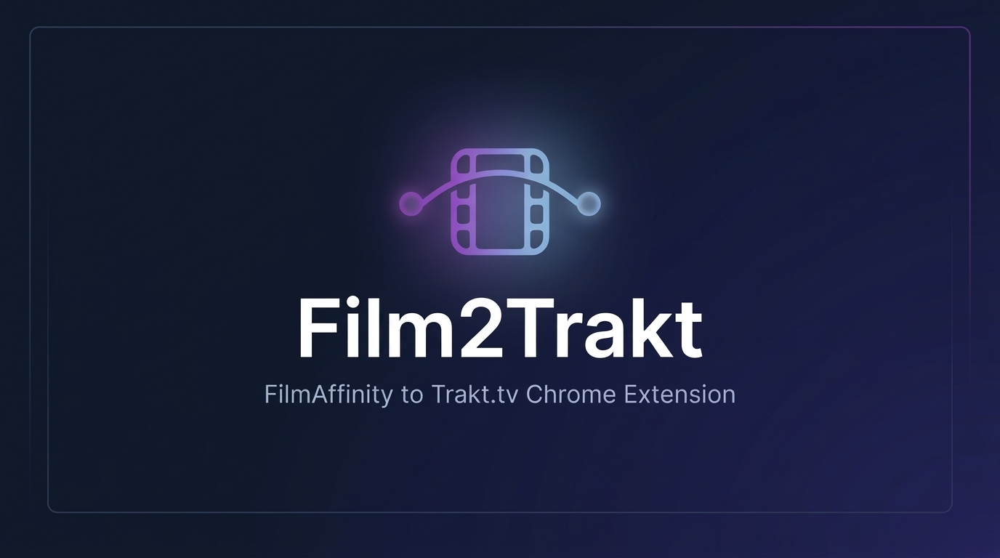
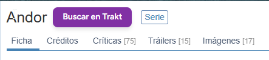
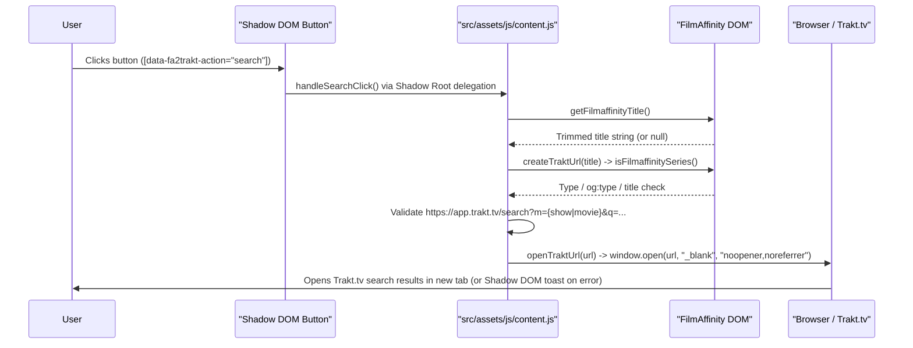

<div align="center">



# Film2Trakt

**One-click bridge from FilmAffinity movie and series pages directly to Trakt.tv search results.**

A lightweight, zero-dependency Chrome Manifest V3 extension built with vanilla ES6+ JavaScript, Shadow DOM-scoped CSS3, and Chrome `i18n` localization.

<p>
  <a href="#overview">Overview</a> ·
  <a href="#quick-start">Quick Start</a> ·
  <a href="#capabilities">Capabilities</a> ·
  <a href="#architecture">Architecture</a> ·
  <a href="#installation">Installation</a> ·
  <a href="#documentation">Documentation</a> ·
  <a href="#author">Author</a>
</p>

[](#architecture)
[](#documentation)
[](#license)
[](https://github.com/seyerjo/fa2trakt/commits/main)

</div>

---

## Overview

Users who discover or rate films and TV shows on [FilmAffinity](https://www.filmaffinity.com/) while tracking their watch history on [Trakt.tv](https://trakt.tv/) normally have to copy titles manually, switch tabs, choose between movies and shows, and run a new search.

**Film2Trakt** eliminates that friction with a single-purpose Manifest V3 content script. It injects an isolated Shadow DOM **Search on Trakt** (**Buscar en Trakt**) button directly beside the page heading on Spanish and English FilmAffinity title pages, detects whether the entry is a movie or a series, validates and encodes the target HTTPS Trakt search URL, and opens it safely in a new tab—with zero install-time API permissions, no background service worker, no external libraries, and no runtime tracking.

## Quick Start

1. Open Google Chrome and navigate to `chrome://extensions`.
2. Enable **Developer mode** and click **Load unpacked**, then select the `src` folder inside this repository (`fa2trakt/src`).
3. Visit any Spanish or English FilmAffinity title page matching `https://www.filmaffinity.com/es/film*.html` or `https://www.filmaffinity.com/en/film*.html`.
4. Click the injected **Buscar en Trakt** / **Search on Trakt** button next to the main title to open `https://app.trakt.tv/search?m=movie&q=...` or `https://app.trakt.tv/search?m=show&q=...` in a new tab.



## Capabilities

- **One-Click Idempotent Trakt Lookup:** Guards against duplicate injections (`[data-fa2trakt-root="button"]`), inserts a Shadow DOM search button after the title `<span>` inside `h1#main-title` (with direct-append fallback), and opens validated URLs via `window.open(url, "_blank", "noopener,noreferrer")`.
- **Resilient Title Extraction:** Uses immutable frozen DOM selectors (`Object.freeze(SELECTORS)`) to extract and trim the primary title from `h1#main-title span`, falling back to direct text nodes inside `h1#main-title` if the inner `<span>` is absent.
- **Bilingual Movie vs. Series Detection:** Inspects `.movie-type .type` for Spanish and English series labels (`Serie`, `Miniserie`, `Serie de TV`, `Miniserie de TV`, `Series`, `Miniseries`, `TV Series`, `TV Miniseries`) with `meta[property="og:type"]` (`video.tv_show`) and `document.title` fallbacks to route queries to `m=show` or `m=movie` on `app.trakt.tv/search`.
- **Shadow DOM Style Isolation & Accessibility:** Encapsulates both the search button and non-intrusive error toast notifications in open Shadow Roots styled via `src/assets/css/content.css` (`:host` custom properties, `:focus-visible`, `@media (max-width: 768px)`, and `prefers-reduced-motion`).
- **Native Chrome Localization (`i18n`):** Supports Spanish (`src/_locales/es/messages.json`, `default_locale: "es"`) and English (`src/_locales/en/messages.json`) with cached fallback strings for extension context invalidation.
- **Zero-Trust Manifest V3 Security:** Requires zero install-time API permissions, restricts `content_scripts` to HTTPS FilmAffinity title URLs (`run_at: "document_idle"`), scopes `web_accessible_resources` to `https://www.filmaffinity.com/*` with `"use_dynamic_url": true`, validates outbound `https://app.trakt.tv/search` URLs, and enforces `script-src 'self'; object-src 'self'` via CSP.

## Architecture



- **Core Stack:** Chrome Extensions Manifest V3, Vanilla JavaScript (ES6+ isolated inside an IIFE in `src/assets/js/content.js`), Shadow DOM + CSS3 (`src/assets/css/content.css`), and Chrome `i18n` API (`src/_locales/{es,en}/messages.json`).
- **Design & Reliability:** Zero runtime dependencies or frameworks; frozen `SELECTORS`, `CONFIG`, and `ACTIONS` maps; `AbortController` event lifecycle cleanup on `pagehide`; non-blocking Shadow DOM toast notifications instead of `alert()`.

<details open>
<summary>Project Structure</summary>

```text
fa2trakt/
├── .github/
│   └── assets/
│       ├── avatar.png                    # Local circular author avatar
│       ├── banner.png                    # Local panoramic repository banner
│       └── image_fa2trakt_button.png     # UI screenshot for README
├── docs/
│   ├── 01_project_blueprint.md           # Vision, requirements, and feature specs
│   └── 02_engineering_guidelines.md      # Architecture, tech stack, setup, and style guide
├── src/
│   ├── _locales/
│   │   ├── en/
│   │   │   └── messages.json             # English i18n strings
│   │   └── es/
│   │       └── messages.json             # Spanish i18n strings (default_locale)
│   ├── assets/
│   │   ├── brand/                        # Extension icons (16/48/128px)
│   │   ├── css/
│   │   │   └── content.css               # Shadow DOM scoped button & toast styles
│   │   └── js/
│   │       └── content.js                # Core DOM extraction, URL validator, and Shadow DOM UI
│   └── manifest.json                     # Manifest V3 definition (zero permissions, dynamic WAR, CSP)
├── CHANGELOG.md                          # Semantic Versioning release history
├── LICENSE                               # Apache License 2.0
└── README.md                             # Project documentation
```

</details>

## Installation

### Prerequisites

- **Google Chrome** (latest stable release)
- **Git** (only required if installing from source)

### From GitHub Releases

1. Download the latest `.zip` archive from the [Releases page](https://github.com/seyerjo/fa2trakt/releases/latest).
2. Extract the archive to a local folder.
3. Open `chrome://extensions`, enable **Developer mode**, click **Load unpacked**, and select the extracted extension folder containing `manifest.json`.

### From Source

```bash
git clone https://github.com/seyerjo/fa2trakt.git
cd fa2trakt
```

1. Open `chrome://extensions` in Google Chrome.
2. Toggle **Developer mode** on in the top-right corner.
3. Click **Load unpacked** and select `fa2trakt/src` (where `manifest.json` lives).
4. Whenever you edit files under `src/`, click the reload icon on the **Film2Trakt** card in `chrome://extensions`.

## Documentation

- **[Changelog](./CHANGELOG.md):** Release history and version milestones.
- **[Project Blueprint](./docs/01_project_blueprint.md):** Vision, requirements, and feature specifications.
- **[Engineering Guidelines](./docs/02_engineering_guidelines.md):** Technical architecture, tech stack, local setup, and code style standards.

## License

Licensed under the **Apache-2.0** License — see **[LICENSE](./LICENSE)** for details.

## Author

<p>
  <a href="https://github.com/seyerjo">
    
  </a>
  <strong>Jose Miguel Reyes</strong><br />
  Senior IT Consultant, CTO/CIO, and Full Stack Developer focused on Data Analytics, AI, and clean software engineering.
</p>

<br clear="left" />

<p><em><strong>"Engineering for the future."</strong></em></p>

<p>
  <a href="https://github.com/seyerjo"></a>
  <a href="https://josemreyes.com"></a>
  <a href="https://www.linkedin.com/in/seyerjo"></a>
  <a href="https://x.com/seyerjo"></a>
  <a href="https://github.com/seyerjo/fa2trakt/issues"></a>
</p>

> **Find this repository useful?** Consider giving it a star to support the project and bookmark it for future reference:
>
> [](https://github.com/seyerjo/fa2trakt)
>
> Have a technical question or suggestion? Open an **[Issue](https://github.com/seyerjo/fa2trakt/issues)**.
