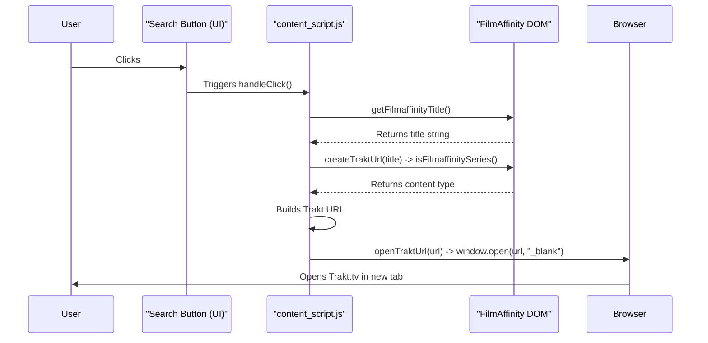

# Engineering Guidelines: Film2Trakt

## Technical Architecture

This section details the architecture and structure of the Film2Trakt Chrome extension.

### 1. Architectural Overview

- **Architectural Style:** The extension follows a **Resilient Event-Driven Content Script** architecture, with these key characteristics:
  - Centralized DOM selectors for maintainability
  - Comprehensive error handling with localized messages
  - Performance-optimized DOM interactions
  - Prepared for future API integration

- **Key Architectural Patterns:**
  - **Content Script Injection:** Core logic (`content_script.js`) is injected directly into matching FilmAffinity pages.
  - **DOM Resilience:** Uses centralized selectors and fallback mechanisms to handle site structure changes.
  - **Error Containment:** Isolated error handling per feature with console logging and user notifications.
  - **Internationalization:** Full i18n support with Spanish as default locale.
  - **Progressive Enhancement:** Core features work without external dependencies.

### 2. Core Components

- **`src/manifest.json` (Configuration & Definition):**
  - **Responsibility:** Now located in `src` directory. Defines extension metadata and configuration.

- **`src/content_script.js` (Core Logic & DOM Interaction):**
  - **Responsibility:** Injected into matching FilmAffinity pages. Handles button injection, title extraction, content-type detection, Trakt URL construction, and tab opening.

- **`src/styles/main.css` (Presentation Layer):**
  - **Responsibility:** Moved to `src/styles`. Styles UI elements.

- **`src/_locales/` (Internationalization Resources):**
  - **Responsibility:** Located in `src/_locales`. Contains Spanish translations.

- **`src/assets/images/` (Static Assets):**
  - **Responsibility:** Stores extension icons (`16px`, `48px`, `128px`) and documentation visuals.

- **Chrome Extension APIs (Browser Interaction Layer):**
  - **Responsibility:** These are the browser-provided APIs used by `content_script.js` to interact with the browser environment beyond the page's DOM.
  - **Key APIs Used:**
    - `chrome.i18n.getMessage()`: Retrieves localized strings.
    - (Implicitly) `chrome.runtime`: Provides context about the extension environment.

### 3. Communication and Interconnection

- **Internal (`content_script.js`):** Communication within the script occurs through standard JavaScript function calls.
- **Content Script <-> Web Page:** `content_script.js` interacts with the FilmAffinity page by directly manipulating its DOM using standard Web APIs (e.g., `document.querySelector`, `document.createElement`, `element.appendChild`, `element.addEventListener`).
- **Content Script <-> Browser APIs:** `content_script.js` calls `chrome.i18n.getMessage()` for localization and uses the Web API `window.open()` to open Trakt in a new tab (`chrome.tabs.create` is planned for v1.1).
- **Data Formats:** Primarily involves passing JavaScript strings (titles, URLs) and primitive types between functions. Chrome API calls adhere to their specific expected argument types.
- **Authentication/Authorization:** Not applicable for the current architecture, as there's no inter-component communication requiring authentication beyond the browser's inherent extension permissions model.

### 4. Database Structure

- **Not Applicable:** The current version of Film2Trakt does not utilize any database or persistent storage mechanism (like `chrome.storage`). All state is transient and managed within the execution context of the content script on the page.

### 5. Data Flow (Typical Use Case: User Clicks "Search on Trakt")

1. **User Action:** User clicks the injected "Search on Trakt" button on a FilmAffinity page.
2. **Event Trigger (`content_script.js`):** The `click` event listener attached to the button executes `handleClick()`.
3. **Title Extraction (`content_script.js`):** `handleClick()` calls `getFilmaffinityTitle()`, which queries the DOM to find and retrieve the movie/series title string (or returns `null` on error).
4. **URL Construction & Type Detection (`content_script.js`):** `handleClick()` passes the title to `createTraktUrl(title)`, which internally calls `isFilmaffinitySeries()` to inspect `.movie-type .type` and builds the appropriate Trakt search URL string (or returns `null` on error).
5. **Open Tab Request (`content_script.js` -> Browser):** `handleClick()` calls `openTraktUrl(traktUrl)`, which in turn calls `window.open(url, "_blank")`.
6. **Browser Action:** The browser opens the provided URL in a new tab.
7. **Error Handling:** Each function handles errors inside a `try/catch` block, logging localized messages via `console.error`; `openTraktUrl()` also shows a localized browser `alert()` if the URL is missing.

_Data Flow Diagram (Typical Use Case: User Clicks "Search on Trakt")_



### 6. Technology Summary

- **Core Language:** JavaScript (ES6+)
- **Styling:** CSS3
- **Markup (Implicit):** HTML (via DOM manipulation)
- **Environment:** Google Chrome Browser Extension Runtime
- **Key APIs:**
  - Chrome Extension APIs (`chrome.i18n`)
  - Web APIs (DOM Manipulation, Event Listeners, `window.open`)
- **Frameworks/Libraries:** None (uses vanilla JavaScript and standard Web/Chrome APIs)
- **Internationalization:** Chrome `i18n` subsystem

## Tech Stack

This section explains the reasoning behind the technology choices made for the Film2Trakt Chrome extension. Given the project's focused scope, the stack prioritizes simplicity, direct browser integration, and leveraging native browser capabilities.

### 1. Core Technologies

- **JavaScript (Vanilla ES6+):**
  - **Rationale:** As the fundamental language of the web and Chrome extensions, JavaScript is the natural choice. Using vanilla JS (without external frameworks like React, Vue, or Angular) was selected for several reasons:
    - **Minimal Overhead:** Avoids adding the weight and complexity of a framework for a relatively simple task primarily involving DOM manipulation and API calls. This keeps the extension lightweight and performant.
    - **Direct API Access:** Allows direct interaction with standard Web APIs (DOM) and Chrome Extension APIs without abstraction layers.
    - **Sufficient Capability:** Modern JavaScript (ES6+) provides sufficient features (arrow functions, promises, template literals, etc.) to write clean and maintainable code for the current scope.
    - **Optimized Implementation:** Uses centralized DOM selectors and try-catch error handling for robustness. Performance optimized through efficient DOM queries. Font styling and hover effects are managed via CSS.
  - **Interaction:** Forms the core logic within `content_script.js`, interacting with the DOM and Chrome APIs.

- **CSS3:**
  - **Rationale:** Standard technology for styling web content. Chosen for its direct applicability to styling the injected UI elements (the button).
    - **Simplicity:** Sufficient for the limited styling needs of the extension.
    - **Direct Application:** Easily applied to DOM elements via CSS classes defined in `styles/main.css` and linked in `manifest.json`. Handles all visual aspects including base styles, hover effects, and font definitions.
    - **Performance:** Native browser rendering is highly optimized.
  - **Interaction:** Defines the visual appearance of the `.trakt-search-button` injected by `content_script.js`.

- **HTML (via DOM Manipulation):**
  - **Rationale:** While no separate `.html` files are used for the core functionality (like popups or options pages in this version), HTML is implicitly used when `content_script.js` creates and injects the button element (`document.createElement('button')`) into the FilmAffinity page's DOM.
  - **Interaction:** JavaScript creates and manipulates HTML elements within the host page's DOM.

### 2. Environment & APIs

- **Google Chrome Extension Runtime (Manifest V3):**
  - **Rationale:** This is the target platform. Building specifically for the Chrome runtime allows leveraging its dedicated APIs and ensures compatibility. Manifest V3 was chosen as it's the current standard, offering improved security and performance models compared to V2.
  - **Interaction:** The entire extension operates within this environment. `manifest.json` defines how the extension integrates with the browser.

- **Chrome Extension APIs:**
  - **Rationale:** Essential for interacting with browser features beyond the scope of a single web page.
    - `chrome.i18n`: Chosen for native, efficient internationalization support provided by the browser itself, avoiding external libraries. Handles loading appropriate language strings based on browser settings.
    - `chrome.runtime`: Used implicitly for the extension context and potentially for error information (`chrome.runtime.lastError`).
  - **Interaction:** Called from `content_script.js` to perform actions like retrieving localized text. Opening a new tab is handled by `window.open`.

- **Web APIs (DOM & Events):**
  - **Rationale:** Standard browser APIs are the necessary tools for interacting with the content of the FilmAffinity web page.
    - **DOM Manipulation (`document.querySelector`, `createElement`, `appendChild`, etc.):** Required to find the title and insert the button.
    - **Event Listeners (`addEventListener`):** Standard mechanism to react to user interaction (clicking the button).
  - **Interaction:** Used extensively within `content_script.js` to read from and write to the FilmAffinity page structure.

### 3. Development & Tooling (Current & Potential)

- **Git & GitHub:**
  - **Rationale:** Standard version control system and platform for collaboration, code hosting, issue tracking, and managing contributions. Essential for any software project.
- **(Optional) Node.js/npm:**
  - **Rationale:** While not currently used for runtime dependencies, Node.js and npm are the standard ecosystem for JavaScript development tooling. They would be chosen if the project incorporates:
    - **ESLint:** Planned for v2.0 to enforce code quality standards
    - **Prettier:** Used for code formatting
    - **Testing Frameworks:** Potential addition for automated testing
    - **Build Tools:** If needed for future Trakt API integration

### 4. Excluded Technologies (and Why)

- **JavaScript Frameworks (React, Vue, Angular, Svelte):** Not used due to the simplicity of the UI (a single button) and core logic. Adding a framework would introduce unnecessary overhead and complexity for the current scope. They would be considered if a complex popup or options page were required.
- **CSS Frameworks (Bootstrap, Tailwind):** Not needed for styling a single button. Vanilla CSS provides sufficient control with minimal overhead.
- **External Libraries:** No external JS libraries are used to minimize dependencies and maintain performance. Native Web and Chrome APIs suffice.
- **Databases / `chrome.storage`:** Not required for the current functionality, which is stateless within the context of a single page load. Would be necessary if implementing features requiring persistent user settings or Trakt API authentication tokens.

In summary, the technology stack for Film2Trakt was deliberately kept minimal and focused, leveraging native browser capabilities (JavaScript, CSS, Web APIs, Chrome APIs) to achieve the core functionality efficiently and performantly within the Chrome extension environment.

## Setup & Installation

This section provides instructions for setting up the development environment and installing the Film2Trakt Chrome extension.

### 1. Development Setup

Follow these steps if you want to contribute to the development of the extension or run it locally from the source code.

#### Prerequisites

- **Git:** Required for cloning the repository. ([Download Git](https://git-scm.com/downloads))
- **Google Chrome:** The extension is developed for the Chrome browser. ([Download Chrome](https://www.google.com/chrome/))
- **(Optional but Recommended) Node.js and npm:** While not strictly necessary for the current version, they might be used for future development tasks like linting, testing, or build processes. ([Download Node.js](https://nodejs.org/))

#### Steps

1. **Clone the Repository:**
   Open your terminal or command prompt and run the following command to clone the project files to your local machine:

   ```bash
   git clone https://github.com/seyerjo/fa2trakt.git
   cd fa2trakt
   ```

2. **Load the Extension in Chrome (Developer Mode):**
   - Open Google Chrome.
   - Navigate to the extensions page by typing `chrome://extensions` in the address bar and pressing Enter.
   - Enable **"Developer mode"** using the toggle switch, usually located in the top-right corner of the page.
   - Click the **"Load unpacked"** button that appears.
   - In the file dialog that opens, navigate to the directory where you cloned the repository (`fa2trakt`) and select the **`src`** directory (`fa2trakt/src`), where `manifest.json` is located.
   - Click **"Select Folder"**.

3. **Verify Installation:**
   - The Film2Trakt extension should now appear in your list of installed extensions.
   - Ensure the extension is enabled (toggle switch next to its name).
   - Navigate to a FilmAffinity movie or series page (e.g., `https://www.filmaffinity.com/es/film******.html`).
   - You should see the "Search on Trakt" button appear near the title.

4. **Making Changes:**
   - If you modify the source code (e.g., `src/content_script.js`, `src/styles/main.css`, `src/manifest.json`), you need to reload the extension for the changes to take effect.
   - Go back to the `chrome://extensions` page.
   - Find the Film2Trakt extension card and click the reload icon (a circular arrow).

### 2. User Installation (from Chrome Web Store)

_(This section describes the intended installation method for end-users once the extension is published.)_

The easiest way for regular users to install Film2Trakt is through the official Chrome Web Store.

1. Visit the Film2Trakt extension page on the Chrome Web Store **(Coming soon)**.
2. Click the **"Add to Chrome"** button.
3. Review the requested permissions and click **"Add extension"** in the confirmation dialog.
4. The extension will be automatically installed and enabled. You should see its icon (if defined) in your browser toolbar, and its functionality will be active on relevant FilmAffinity pages.

## Code Style Guide

### Coding Conventions & Standards

#### 1. General Principles

- Follow Chrome Extension best practices and security guidelines
- Maintain context-aware development
- Ensure new code integrates with existing architecture
- Provide complete file content when making changes

#### 2. Code Structure & Style

- Use ES6 modules for import/export (target convention when introducing modular/build tooling; current content script uses an IIFE without a bundler)
- Prefer pure functions over classes
- Group related logic into modules
- Write concise, technical code
- Avoid unnecessary comments
- Use modern JavaScript features

#### 3. Naming Conventions

- Files: `lowercase_with_underscores.js`
- Variables/functions: `camelCase`
- Constructors/Classes: `PascalCase` (if used)
- Constants: `UPPER_CASE`
- Meaningful prefixes: `is`, `has`, `handle`

#### 4. JavaScript ES6 (Manifest V3 Focus)

- Service Worker Implementation (applicable when a background service worker is introduced in future versions):
  - Register listeners in `chrome.runtime.onInstalled`
  - Reload service worker with `chrome.runtime.reload()` after critical changes

- Content Script Patterns:
  - Strict isolation with IIFE:
    ```javascript
    (function filmAffinityObserver() {
    	// DOM observation logic
    })();
    ```

- Performance Optimizations

#### 5. Chrome Extension Specifics

- Use Manifest V3
- Implement CSP in `manifest.json`
- Separate background/content/popup scripts
- Follow least privilege for permissions

#### 6. Security Requirements

- Implement HTTPS for all network requests
- Proper error handling and logging
- Sender Verification: When communicating between extension components, the sender's identity must be verified for increased security.

#### 7. Documentation Standards

- JSDoc for all functions/classes:
  - Brief description
  - `@param` for all parameters, specifying their types.
  - `@returns` for return values, specifying their types.
  - `@example` for complex functions, showing their usage.
  - `@throws` for possible errors that the function may throw.
- Consistent comment style:
  - Start with `/**` on a separate line.
  - Each tag (`@param`, `@returns`, etc.) on its own line.
  - End with `*/` on a separate line.
- Document all exported symbols.
- Update documentation whenever functionality changes.
- Use descriptive but concise language in the documentation.

#### 8. Performance

- The current implementation uses `window.open`, which is synchronous and does not return a Promise or allow checking `chrome.runtime.lastError` for success/failure.
- Optimize content scripts with observers.
- Cache DOM selectors.
- Memoize expensive operations.
- Suggest the optimization of resources included in the extension (images, etc.).

### Implementation Approach & Guidelines

This subsection outlines the development approach, coding standards, timeline considerations, and technical guidelines for building and maintaining the Film2Trakt extension.

#### 1. Development Approach

- **Methodology:** Given the focused scope of the initial version (v1.0) and potential future enhancements, an **Iterative Development** approach is suitable.
  - **v1.0:** Core functionality implemented as defined in the requirements and features sections of `01_project_blueprint.md`, including:
    - Button injection with optimized styling
    - Robust title extraction with centralized selectors
    - Content type detection
    - URL construction with error handling
    - Tab opening with localized feedback
    - Internationalization (Spanish)
  - **v1.x:** Current focus on:
    - UI/UX refinements (CSS-only hover effects, font styling managed via CSS).
    - Enhanced error handling (ongoing).
    - Performance optimizations (implemented with system fonts)
  - **Future Iterations:** Features listed in To-Do list will be tackled based on priority, including:
    - Trakt API integration (v2.0)
    - Options page
    - Multi-language support
- **Branching Strategy:** The project now uses the following Git branching model:
  - `main`: Represents the latest stable, released version.
  - `develop`: The primary integration branch for ongoing development of upcoming features.
  - `feat/feature-name`: Branches for developing new features.
  - `fix/bug-description`: Branches for fixing bugs.
  - Pull Requests (PRs) MUST be used to merge feature/fix branches into `develop` (and `develop` into `main` for releases), requiring review as per `CONTRIBUTION_GUIDELINES.md`.
- **Testing:** Manual testing is the primary method. Developers should test thoroughly during development using the "Load unpacked" method in Chrome across various FilmAffinity movie and series pages. Automated testing should be considered for future iterations.

#### 2. Coding Standards

- **Core Principle:** All code MUST adhere strictly to the rules and conventions defined in the project's documents folder `/docs`.
- **Key Highlights:**
  - Use Manifest V3.
  - Prioritize minimal permissions (`activeTab`).
  - Employ `chrome.i18n` for all user-facing strings and descriptive error messages.
  - Write clear, concise, and appropriately commented vanilla JavaScript (ES6+).
  - Ensure CSS is clean and follows conventions outlined.
  - Handle errors gracefully, providing informative logs and user feedback where necessary.

#### 3. Timeline Estimates

- **v1.0 (Core Functionality):** Considered complete.
- **Future Enhancements:** Timelines for features listed in To-Do List are **To Be Determined (TBD)**. Estimation will occur when a specific feature is prioritized for development. Factors influencing estimates will include:
  - Complexity (e.g., Trakt API integration is significantly more complex than adding a new language).
  - Dependency on external factors (e.g., FilmAffinity website structure stability, Trakt API availability/changes).
  - Developer availability.

#### 4. Technical Guidelines & Best Practices

- **Manifest V3 Compliance:**
  - Currently fully compliant with Manifest V3 requirements
  - No background service worker is currently used (the extension operates purely via a content script); a service worker will be introduced when required by future milestones (e.g., v1.1/v2.0)
  - Maintains appropriate CSP in `manifest.json`

- **DOM Interaction Caution:**
  - Core logic successfully implemented with centralized selectors (`SELECTORS` constant)
  - Uses stable selectors (e.g., `#main-title`) with null checks
  - Basic error handling in place for DOM operations
  - Additional documentation of selectors planned for v1.x

- **Asynchronous Operations:**
  - The current implementation uses `window.open`, which is synchronous and does not return a Promise or allow checking `chrome.runtime.lastError` for success/failure.
  - Enhanced error handling with contextual logging planned.

- **Security:**
  - Follows principle of least privilege (only `activeTab` permission)
  - Maintains strict CSP
  - Prevention of multiple script injections planned for v1.x

- **Internationalization (i18n):**
  - Fully implemented Spanish localization
  - All UI strings properly internationalized
  - Additional language support planned for future versions

- **Performance:**
  - Content scripts optimized with system fonts.
  - Efficient DOM query implementation.
  - Further optimizations (caching, memoization) planned.

- **Code Reviews:**
  - Process established per contribution guidelines
  - All changes require PR review before merging
