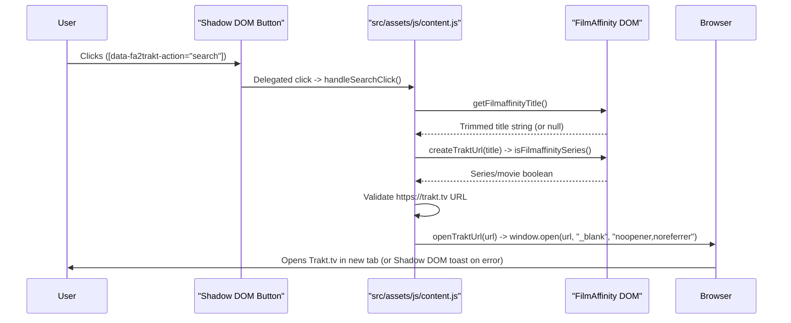

# Engineering Guidelines: Film2Trakt

## Technical Architecture

This section details the architecture and structure of the Film2Trakt Chrome extension.

### 1. Architectural Overview

- **Architectural Style:** The extension follows a **Resilient Event-Driven Content Script with Shadow DOM Encapsulation** architecture, featuring:
  - Frozen centralized DOM selectors (`Object.freeze(SELECTORS)`) and configuration constants
  - Open Shadow DOM roots for both the injected search button and toast notifications
  - Zero install-time API permissions and hardened `web_accessible_resources` (`use_dynamic_url: true`)
  - Lifecycle-managed event delegation via `AbortController`
  - Comprehensive error handling with cached localized fallbacks

- **Key Architectural Patterns:**
  - **Content Script Injection:** Core logic (`src/assets/js/content.js`) is injected at `document_idle` into HTTPS Spanish and English FilmAffinity pages.
  - **Shadow DOM Style Isolation:** Extension CSS (`src/assets/css/content.css`) is linked inside each Shadow Root (`:host` variables) rather than injected into the host page document.
  - **DOM Resilience & Idempotency:** Duplicate-injection guards (`[data-fa2trakt-root="button"]`), inner-span fallbacks, and metadata/title fallbacks for content-type detection.
  - **Zero-Trust Validation:** Strict `https://trakt.tv` URL validation and `window.open(url, '_blank', 'noopener,noreferrer')`.
  - **Internationalization:** Full Chrome `i18n` support for Spanish (`es`, default) and English (`en`).

### 2. Core Components

- **`src/manifest.json` (Configuration & Definition):**
  - **Responsibility:** Defines Manifest V3 metadata, zero API permissions, HTTPS-only `content_scripts` matches (`/es/` and `/en/`), `run_at: "document_idle"`, hardened `web_accessible_resources`, `default_locale`, and strict CSP.

- **`src/assets/js/content.js` (Core Logic, Shadow DOM UI & Extraction):**
  - **Responsibility:** Injected into matching FilmAffinity pages. Handles idempotent Shadow DOM button mounting, title extraction, bilingual content-type detection, HTTPS URL construction/validation, safe tab opening, non-intrusive Shadow DOM toast notifications, and `pagehide` teardown.

- **`src/assets/css/content.css` (Shadow DOM Presentation Layer):**
  - **Responsibility:** Scoped stylesheet loaded inside the extension's Shadow Roots. Styles `.fa2trakt-button` and `.fa2trakt-toast` using `:host` custom properties, `:focus-visible`, responsive breakpoints, and `prefers-reduced-motion`.

- **`src/_locales/` (Internationalization Resources):**
  - **Responsibility:** Contains `es/messages.json` (default) and `en/messages.json` localization bundles.

- **`src/assets/brand/` (Brand Icons):**
  - **Responsibility:** Stores extension icons (`16px`, `48px`, `128px`). Documentation screenshots live outside `src/` under `.github/assets/` so release archives stay minimal.

- **Chrome Extension APIs (Browser Interaction Layer):**
  - **Key APIs Used:**
    - `chrome.i18n.getMessage()`: Retrieves localized strings (wrapped with `try/catch` and cached fallbacks).
    - `chrome.runtime.getURL()`: Resolves the dynamic `web_accessible_resources` URL for `assets/css/content.css`.

### 3. Communication and Interconnection

- **Internal (`src/assets/js/content.js`):** Modular helper functions inside a strict IIFE separating runtime helpers, pure extraction/URL logic, and Shadow DOM UI management.
- **Content Script <-> Web Page:** Reads FilmAffinity DOM via standard Web APIs (`document.querySelector`) and mounts isolated Shadow DOM host elements (`[data-fa2trakt-root="button"]`, `[data-fa2trakt-root="toast"]`) without injecting HTML strings or modifying global CSS.
- **Content Script <-> Browser APIs:** Calls `chrome.i18n.getMessage()` and `chrome.runtime.getURL()` defensively, and opens Trakt via `window.open(url, '_blank', 'noopener,noreferrer')`. (`chrome.tabs.create` is deferred to `v2.0` alongside the introduction of a background Service Worker.)
- **Authentication/Authorization:** Not applicable in `v1.x`; planned for `v2.0` OAuth 2.0 integration.

### 4. Database Structure

- **Not Applicable:** The current version of Film2Trakt does not utilize any database or persistent storage (`chrome.storage`). All state is transient within the content script execution context.

### 5. Data Flow (Typical Use Case: User Clicks "Search on Trakt")

1. **Initialization (`initialize()`):** At `document_idle`, verifies no existing button host is mounted, creates an open Shadow Root on `h1#main-title`, links `assets/css/content.css`, and attaches delegated click and `pagehide` listeners using `lifecycleController.signal`.
2. **User Action:** User clicks the Shadow DOM button (`[data-fa2trakt-action="search"]`).
3. **Title Extraction:** `handleSearchClick()` calls `getFilmaffinityTitle()`, which queries `h1#main-title span` (with direct text-node fallback). If `null`, displays a localized Shadow DOM toast and aborts cleanly.
4. **URL Construction & Type Detection:** `createTraktUrl(title)` calls `isFilmaffinitySeries()` (checking `.movie-type .type`, `og:type`, and `document.title`), encodes the title, and validates the `https://trakt.tv/search/{shows|movies}` URL via `isValidTraktUrl()`.
5. **Open Tab Request:** `openTraktUrl(traktUrl)` validates the URL again and executes `window.open(url, '_blank', 'noopener,noreferrer')`. Any thrown exception logs a localized error and displays a dismissible Shadow DOM toast.

_Data Flow Diagram (Typical Use Case: User Clicks "Search on Trakt")_



### 6. Technology Summary

- **Core Language:** JavaScript (ES6+, strict IIFE)
- **Styling:** CSS3 scoped inside open Shadow DOM roots
- **Markup (Implicit):** Safe DOM APIs only (`document.createElement`, `textContent`, `setAttribute`; zero `innerHTML`)
- **Environment:** Google Chrome Browser Extension Runtime (Manifest V3)
- **Key APIs:** `chrome.i18n.getMessage`, `chrome.runtime.getURL`, DOM/Shadow DOM APIs, `AbortController`, `URL`, `window.open`
- **Frameworks/Libraries:** None

## Tech Stack

This section explains the reasoning behind the technology choices made for the Film2Trakt Chrome extension. Given the project's focused scope, the stack prioritizes simplicity, zero-trust isolation, direct browser integration, and native capabilities.

### 1. Core Technologies

- **JavaScript (Vanilla ES6+):** Chosen to avoid framework bundle overhead while providing clean modular helpers, `Object.freeze()` immutability, `URL` validation, and `AbortController` lifecycle teardown inside a self-contained IIFE.
- **CSS3 + Shadow DOM (`mode: 'open'`):** Isolates both the injected button and error toast notifications from FilmAffinity's host stylesheets, avoiding global `:root` pollution and host CSS overrides. Requires declaring `assets/css/content.css` in `web_accessible_resources` with `"use_dynamic_url": true` restricted to `https://www.filmaffinity.com/*`.
- **HTML via Safe DOM APIs:** Elements are constructed strictly via `document.createElement()`, `textContent`, and `setAttribute()` to eliminate XSS risk.

### 2. Environment & APIs

- **Manifest V3:** Current Chrome extension standard.
- **Zero Install-Time API Permissions:** Static `content_scripts` matched to HTTPS FilmAffinity title pages do not require `activeTab` or broad host permissions.
- **Chrome `i18n` & `runtime.getURL`:** Native localization (`es` and `en`) and dynamic asset resolution without external libraries.

### 3. Development & Tooling

- **Git & GitHub:** Version control and release distribution.
- **Local Tooling Configs (Excluded from Git via `.git/info/exclude`):** `.eslintrc.json`, `.prettierrc.json`, and `jsconfig.json` provide local linting, formatting (4 spaces, single quotes, LF), and JSDoc type checking without adding runtime dependencies.
- **Python Release Script (`.agents/skills/local-release/scripts/build_release.py`):** Validates `manifest.json`, `_locales/*/messages.json`, and `CHANGELOG.md` and builds reproducible `.zip` packages under `.releases/`.

### 4. Excluded Technologies (and Why)

- **UI/CSS Frameworks (React, Vue, Tailwind, etc.):** Unnecessary overhead for a single injected button and lightweight toast notification.
- **Background Service Worker (Deferred to v2.0):** Not required for `window.open(..., '_blank', 'noopener,noreferrer')` from a content script; will be introduced in `v2.0` for Trakt API OAuth 2.0 and `chrome.tabs.create`.
- **Databases / `chrome.storage` (Deferred to v2.0):** Current functionality is stateless per page load.

## Setup & Installation

### 1. Development Setup

#### Prerequisites

- **Git:** ([Download Git](https://git-scm.com/downloads))
- **Google Chrome:** ([Download Chrome](https://www.google.com/chrome/))
- **(Optional) Node.js / Python 3:** Used for local syntax checks, behavioral tests, and `.releases/` packaging.

#### Steps

1. **Clone the Repository:**

   ```bash
   git clone https://github.com/seyerjo/fa2trakt.git
   cd fa2trakt
   ```

2. **Load the Extension in Chrome (Developer Mode):**
   - Open Google Chrome and navigate to `chrome://extensions`.
   - Enable **Developer mode** in the top-right corner.
   - Click **Load unpacked** and select `fa2trakt/src` (where `manifest.json` lives).

3. **Verify Installation:**
   - Ensure **Film2Trakt** is enabled.
   - Navigate to a Spanish or English FilmAffinity title page (`https://www.filmaffinity.com/es/film******.html` or `https://www.filmaffinity.com/en/film******.html`).
   - Confirm the **Buscar en Trakt** / **Search on Trakt** button appears next to the title and opens Trakt.tv in a new tab.

4. **Making Changes:**
   - After editing files under `src/`, return to `chrome://extensions` and click the reload icon on the **Film2Trakt** card.

### 2. User Installation (from Chrome Web Store)

_(Intended installation method once published to the Chrome Web Store.)_

1. Visit the Film2Trakt extension page on the Chrome Web Store **(Coming soon)**.
2. Click **Add to Chrome** and confirm the installation dialog.

## Code Style Guide

### Coding Conventions & Standards

#### 1. General Principles

- Adhere strictly to Chrome Extensions v4.0 standards (MV3, least privilege, Shadow DOM isolation, zero-trust security).
- Write all code, identifiers, JSDoc, comments, and documentation in **English**.

#### 2. Code Structure & Style

- Prefer pure helper functions and early returns; avoid unnecessary comments (document the *why* when non-obvious, e.g., `window.open` returning `null` under `noopener`).
- Match `.prettierrc.json` formatting: 4 spaces, single quotes, semicolons, no trailing commas, LF line endings.
- Content scripts use a strict IIFE (`'use strict'`) so helper functions remain private without exposing JS modules via `web_accessible_resources`.

#### 3. Naming Conventions

- Files: `lowercase_with_underscores.js` or concise role names (`content.js`, `content.css`).
- Variables/functions: `camelCase`.
- Frozen configuration/selector maps: `UPPER_CASE` (`SELECTORS`, `CONFIG`, `ACTIONS`).
- Meaningful boolean/handler prefixes: `is`, `has`, `handle`, `get`, `create`.

#### 4. JavaScript & Manifest V3 Patterns

- Freeze external DOM selector maps (`Object.freeze(SELECTORS)`) with strict null checks and fallbacks.
- Decouple extension-owned UI actions from CSS classes using `data-fa2trakt-*` attributes and Shadow Root event delegation.
- Manage listeners via `AbortController` (`{ signal: lifecycleController.signal }`) and clean up on `pagehide`.
- Never use `innerHTML`, `outerHTML`, `insertAdjacentHTML()`, `document.write()`, `eval()`, or `new Function()`.
- Validate outbound URLs (`https:` + expected origin) and use `"noopener,noreferrer"` on `window.open()`.
- Guard `chrome.i18n.getMessage()` and `chrome.runtime.getURL()` against extension context invalidation.

#### 5. Documentation Standards (JSDoc)

- Provide valid English JSDoc for every function:
  - Concise summary
  - `@param` with types and descriptions
  - `@returns` with types and descriptions
  - `@throws` where applicable

### Implementation Approach & Guidelines

#### 1. Development Approach

- **v1.0.x:** Core MVP functionality for Spanish FilmAffinity pages.
- **v1.1 (Current):** Chrome Extensions v4.0 alignment, Shadow DOM UI (button + toast), zero install-time permissions, security hardening, idempotency, and English (`/en/`) support.
- **v2.0 (Planned):** Background Service Worker (`type: "module"`), `chrome.tabs.create`, Trakt API OAuth 2.0, `chrome.storage`, and `options.html`.

#### 2. Branching Strategy (Aligned with `global_git_rules.md`)

- `main`: Stable branch; never merge feature/topic branches without explicit user approval.
- Dedicated task branches created from `main` for every change: `feature/<name>`, `refactor/<name>`, `fix/<name>`, or `chore/<name>`.
- Follow Conventional Commits (`<type>(<scope>): <imperative lowercase summary>` <= 72 chars).

#### 3. Testing & Code Review

- Run syntax checks (`node --check src/assets/js/content.js`), JSON/i18n parity checks, behavioral DOM/VM checks, and `build_release.py --dry-run` before proposing a merge.
- Perform live Chrome smoke tests via **Load unpacked** on both `/es/film*.html` and `/en/film*.html` movie and series pages before cutting a release.
